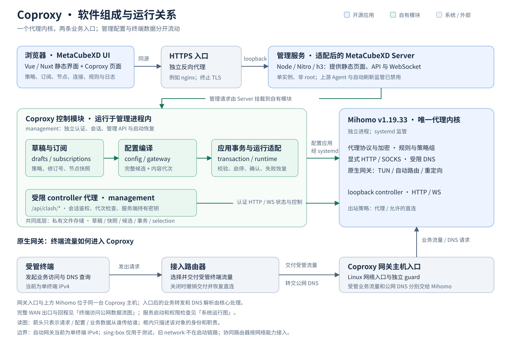
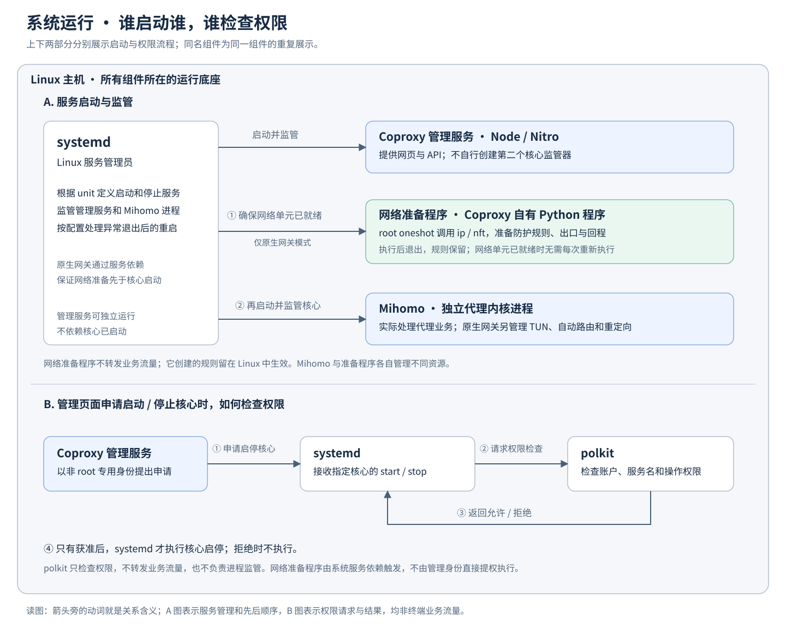
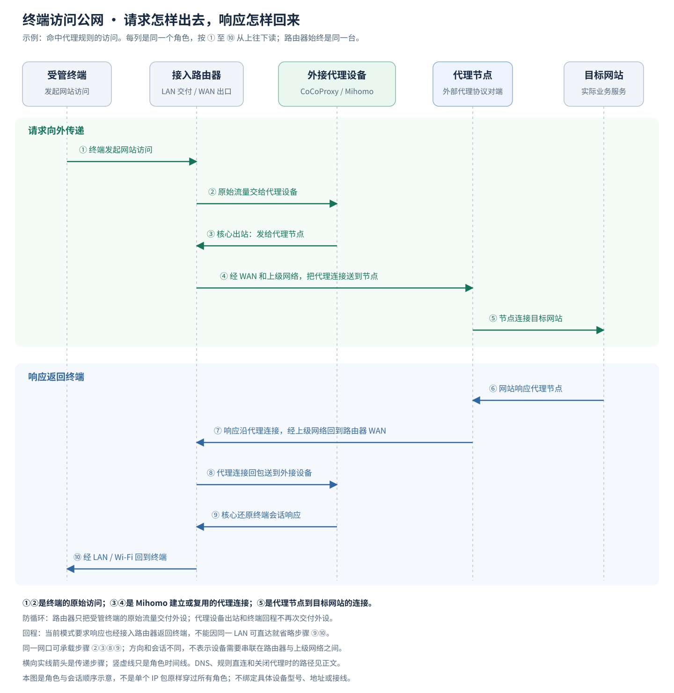
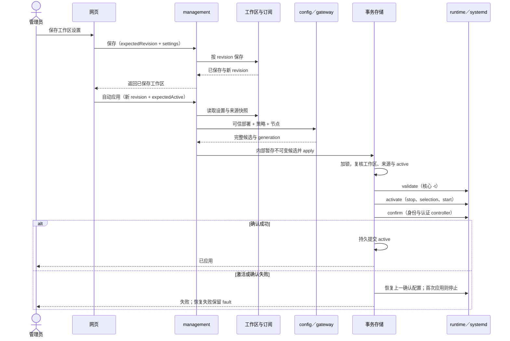

# 软件架构

CoCoProxy 使用 Mihomo 作为唯一运行代理核心，复用 MetaCubeXD UI／Nitro Server，自行维护认证、工作区、订阅、配置事务、运行核验和部署集成。管理服务与业务流量分开，systemd 负责核心监管。支持范围与验收结论统一见[发行说明](release-notes.md)。

## 组件与进程

蓝色为复用组件，绿色为自有模块，灰色为系统或外部角色。箭头表示请求、配置或业务数据的传递，响应省略；图中的模块不等于独立进程。

| 组件 | 职责与来源 |
| --- | --- |
| Mihomo | 协议、加密、DNS、分流和原生 TUN 自动接管。固定 v1.19.33，资产及摘要见[审阅数据](../integrations/metacubexd/review.json) |
| MetaCubeXD UI／Server | 页面与同源 API 宿主。固定 v1.273.1，通过 overlay 接入自有管理；上游 Agent、自动拉核和刷新应用入口禁用。见[构建说明](../integrations/metacubexd/README.md) |
| Node.js、ws、yaml、web-push | 管理和 CLI 运行环境、实时流、订阅解析及通知加密签名；版本由[包元数据](../package.json)与锁文件固定 |
| Linux/systemd、polkit、Python、ip/nft | 服务监管、精确启停授权及网络外围集成；条件见[部署](deployment.md) |
| HTTPS 反向代理 | 局域网管理入口的 TLS 终止与 HTTP／WebSocket 转交，见[HTTPS 配置](management-https.md) |

sing-box 只作为[协议测试对端](../integrations/protocol-fixture/README.md)，不进入生产载荷。项目不自行实现代理协议或密码算法。

| 运行单元 | 行为 |
| --- | --- |
| 浏览器 | 访问同源管理 API 和实时流，不持有核心 secret |
| `cocoproxy-management.service` | 单个非 root Node/Nitro 进程，承载管理与静态页面；通过受限 polkit 请求固定核心 start/stop，不取得网络 capability |
| `cocoproxy-mihomo.service` | 启动器核验选择和二进制后以 `execve` 替换为 Mihomo；systemd 为唯一失败重启者 |
| `cocoproxy-gateway-network.service` | 原生模式的 root oneshot，执行 `network.py prepare` 后退出；核心以 Requires/After/BindsTo 依赖它 |
| `cocoproxy-gateway-guard.service` | 原生模式的独立 root oneshot，在本地文件系统就绪后、network-pre 之前执行固定 guard，不等待接口地址；显式 enable，停止仍保留保护 |
| CLI | 按需复用模块，不常驻 |

管理启动时先对未完成事务执行恢复检查。显式启用持久 lifecycle 后，同一管理进程串行检查已提交 active、网络前置及实际核心，依赖晚到或断线恢复后重试；不应用新草稿，systemd 仍是唯一核心进程监管者。pause 与配置事务共锁，跨重启禁止启动器执行，维护仍须 stop 并确认 PID/Job 清零。草稿、工作区、来源快照、候选、事务、selection 和生命周期标记存于私有文件；候选可能含凭据。短期会话仅在管理进程内存中，设备授权摘要另存私有文件，使受信任设备在重启后自动建立会话；退出或设备撤销使关联会话同时失效。root 网络回执与管理状态分开存放。

## 终端流量

显式代理由客户端主动连接核心 loopback HTTP／SOCKS 入口。原生网关则保持终端默认网关为接入路由器，由路由器交付受管流量。管理 Server 不承载业务连接。

图从上向下读。终端原始访问、Mihomo 到代理节点、节点到网站是不同连接／会话，协议可能复用连接。接入路由器先在 LAN 侧交付终端流量，再在 WAN 侧转发外设出站；响应先回 Mihomo 处理，再由终端 `/32` 回程路由经路由器回终端。

| 场景 | 路径 |
| --- | --- |
| 命中代理规则 | 终端 → 路由器 → CoCoProxy；Mihomo 的代理连接 → 同一路由器 WAN → 节点 → 网站，响应按图返回 |
| 命中 DIRECT | 原流量仍先交给 CoCoProxy，Mihomo 直接经路由器 WAN 连接网站，响应先回核心 |
| 路由器关闭交付 | 撤销交付并恢复 DNS，终端通过路由器普通直连 |
| 开启状态下核心／DNS／链路故障 | 保留开启意图，阻断受管外网，不自动改成直连 |
| 普通公网 DNS | 终端 → 路由器 → CoCoProxy 受限 DNS → 部署上游；本地域和无点名称留给基础解析 |

防循环依靠流量分类和路由：路由器保留终端源 IP，排除自身、外设出站和回程；核心以部署接口、mark 和出口表出站，本机其他应用通过 UID 排除保留原出口。交付段不做 SNAT，WAN NAT 可按部署保留。DNS 使用真实地址，TUN DNS hijack 关闭，bootstrap 不循环依赖受管 DNS。DoH/DoT 需单独验证。

原生模式的资源归属：

| 所有者 | 资源与生命周期 |
| --- | --- |
| Mihomo | TUN、自动路由与重定向，正常退出清理自身资源 |
| root oneshot | 独立 guard、标记出口、终端回程及来源／入口策略规则；停止服务仍保留，完整退役按[维护流程](deployment.md#关闭升级与卸载)核验移除，guard 最后移除 |
| 接入路由器 | 来源选择、交付、DNS、IPv6 边界和独立关闭；由路由器自身控制 |

两端能力和参数映射见[路由器协作](cooperating-router-requirements.md)。

## 保存与应用

网页工作区有本地模板、订阅自带方案和旧配置兼容状态。本地模板使用选定来源的节点；订阅方案保留可接受的策略组和规则，并受限展开 provider。部署参数始终由可信配置注入。

网页工作区保存成功后会自动发起应用，无需另点“应用”；底层单独保存工作区、旧草稿保存和 CLI `stage` 不等于应用，仍需显式 `apply`。来源更新仅在已选来源快照变化或工作区已有待生效设置时由网页自动应用；未选来源只更新快照，工具栏“刷新”只重读页面状态。候选捕获由网页应用流程内部完成。`revision` 防并发覆盖，`generation` 标识完整配置，`expectedActive` 防止覆盖新的运行状态。原生候选包含网络设置，草稿摘要不能替代最终代次。

核心状态、节点选择和实时流通过受限 `/api/clash/*`；HTTP/WS 共用会话，修改操作核验代次和共用锁。工作区组选择同时持久化，自动组保留算法。核心密钥不返回浏览器。历史提交、核心就绪、终端连通分别表示不同事实；当前自动状态为 `core_only`，网关路径仍标为 `GATEWAY_PATH_UNVERIFIED`。

## 源码导航

| 入口 | 职责 |
| --- | --- |
| [management](../packages/management/README.md) | 认证、工作区、管理 API、受限 controller、启动恢复 |
| [subscriptions](../packages/subscriptions/README.md) | 来源、下载、完整方案／节点解码、离线快照 |
| [config](../packages/config/README.md)、[drafts](../packages/drafts/README.md) | 纯编译、保护字段和兼容草稿 |
| [transaction](../packages/transaction/README.md) | 不可变候选、锁、运行 CAS、持久提交及恢复 |
| [runtime](../packages/runtime/README.md) | 计划、启动器、受限 systemctl 与核心观察 |
| [gateway](../packages/gateway/README.md) | 原生接管配置及独立 guard／出口／回程 |
| [routing](../packages/routing/README.md) | 本地分流模板与固定资源生成 |
| [deployment](../packages/deployment/README.md) | 服务、权限与文件计划；安装器位于 `apps/deployment/` |
| [MetaCubeXD overlay](../integrations/metacubexd/README.md) | UI、Nitro 路由和构建 |

`packages/storage/private-files.ts` 提供私有原子文件，`packages/mihomo/validator.ts` 包装核心语法校验，`apps/cli/` 复用模块提供命令。当前原生方案的运行与网络证据边界见 [gateway](../packages/gateway/README.md)。
