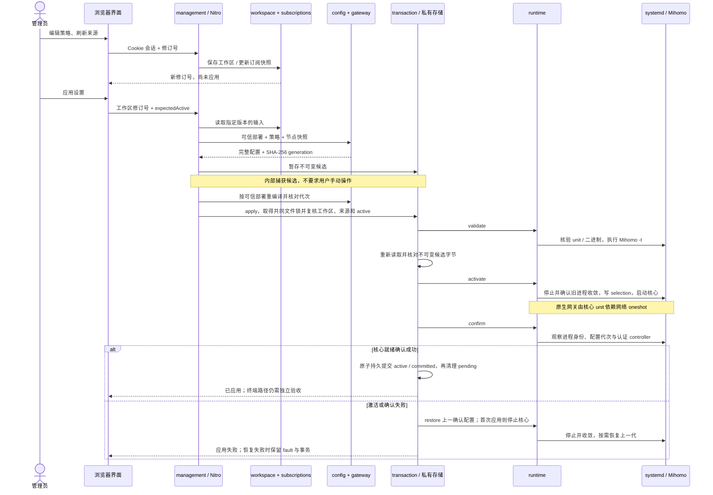

# Coproxy 软件架构

Coproxy 当前由 **Mihomo 代理内核、适配后的 MetaCubeXD 管理界面与 Server、Coproxy 自有管理与可靠性模块，以及 Linux/systemd 运行环境**组成。代理协议、加密、DNS 和分流交给 Mihomo；Coproxy 把用户配置安全地交给内核运行，并补齐登录认证、订阅、配置应用与恢复、网关集成和部署。

本文描述当前实现。早期候选选型见[项目方案](project-plan.md)，验收范围见[开发与验证](development.md)和[路由器协作](router-cooperation.md)。当前是体验版；单一硬件组合或单终端通过不代表所有设备、固件及协议变体均可用。

## 1. 先看整体：软件由什么组成

蓝色表示复用的开源应用，绿色表示 Coproxy 自有模块，灰色表示系统或外部协作组件。**总览图中的箭头只表示请求、配置或业务数据从发起方传到接收方，响应省略**；启动、监管和权限检查单独画在第 2 节的系统运行图中。模块框不代表各自都有独立进程。

Mihomo 左侧的两根绿色箭头分别对应两条管理通道：上方是通过事务和 systemd **应用完整配置**，下方是通过受限 controller API **读取状态或执行节点选择等操作**。二者用途不同。

图下方的**受管终端、接入路由器、Coproxy 网关主机入口是三个不同角色**，分别画为独立方框，以框外箭头连接：终端向路由器发出请求，路由器交付受管业务流量并转交公网 DNS，网关主机入口再将它们交给上方的 Mihomo。网关入口与 Mihomo 位于同一台 Coproxy 主机，前者表示 Linux 网络入口及独立 guard，后者是实际处理代理与 DNS 的核心进程。框内只说明对象身份和职责，不再用文字箭头压缩多个角色之间的链路；响应与回程省略。

- **管理面**：浏览器中的 MetaCubeXD 页面 → 同源管理 Server → Coproxy 认证、策略、订阅和应用事务。管理面决定“运行什么配置”，并读取内核状态。
- **数据面**：显式代理连接或接入路由器转交的流量 → Mihomo → 代理节点或策略允许的直连目标。终端业务流量不经过管理 Server。
- **系统集成**：systemd 监管服务；原生网关模式下，Mihomo 管理自动接管资源，小型 root 网络单元管理独立 guard、标记出口和终端回程资源。

### 用了哪些开源内核和框架

| 组件 | 当前角色与集成方式 | 版本或来源依据 |
| --- | --- | --- |
| **Mihomo** | 当前运行使用的唯一代理内核。独立二进制运行，负责协议、加密、DNS、分流及网关 TUN／自动路由／重定向；Coproxy 生成配置、调用 `-t` 校验并经 systemd 启停 | 固定审阅 **v1.19.33**，提交 `3f27ef39f8c96bbfbc8b0b9bb10f5c9ef60149d8`；架构资产与 SHA-256 见[审阅记录](../integrations/metacubexd/review.json)，许可见 [GPLv3](../integrations/mihomo/LICENSE) |
| **MetaCubeXD UI／Server** | 复用页面和 Server 宿主，经本仓库 overlay 接入 Coproxy 登录、策略／订阅页、API 和事务；原 Agent 的自动拉起、刷新调度和直接改配置入口已禁用 | 固定源码 **v1.273.1**，提交 `8bbc8f58fef71148a94fb5c0ff808f79b057337d`；见[适配记录](../integrations/metacubexd/README.md)及 [MIT 许可](../integrations/metacubexd/LICENSE) |
| **Vue／Nuxt、Nitro／h3** | MetaCubeXD 的界面与服务框架。UI 构建为浏览器静态资源，Nitro Node Server 提供页面和 API／WebSocket 宿主 | 依赖沿用固定上游锁文件；本仓库保留 [UI 配置](../integrations/metacubexd/overlay/packages/ui/nuxt.config.ts)和 [Server 配置](../integrations/metacubexd/overlay/apps/server/nitro.config.ts) |
| **Node.js、ws、yaml** | 自有管理和 CLI 使用 TypeScript／ES modules，运行于 Node.js ≥22.18；`ws` 用于核心实时流连接，`yaml` 用于订阅节点解码 | 根 [package.json](../package.json)与 [package-lock.json](../package-lock.json)固定 `ws` 8.22.0、`yaml` 2.9.0；Node 由目标环境提供 |
| **Linux、systemd、polkit、iproute2、nftables、Python** | 系统平台与工具。systemd 监管进程，polkit 限定核心启停权限；网关 helper 用 Python ≥3.9 标准库调用 `ip`／`nft` | 由目标环境提供，见[部署前提](deployment.md)。Linux 内核与 Mihomo 代理内核是不同层次 |
| **HTTPS 反向代理，例如 nginx** | 远程管理入口的 TLS 终止，将 HTTP／WebSocket 转到 loopback 管理 Server | 独立部署组件，见[管理 HTTPS](management-https.md)；不参与代理协议和业务转发 |

多个协议由同一个 Mihomo 内核处理，并不意味着运行多套代理内核。**sing-box v1.14.4 仅作为协议回环测试的对端服务端**，见[测试夹具](../integrations/protocol-fixture/README.md)，没有进入生产启动链路或发行载荷。v2rayA、ShellCrash、dae 等属于选型对照或参考，没有集成到当前主路径。上游 MetaCubeXD 默认引用的 Mihomo v1.19.27 也不是 Coproxy 当前固定版本。

### 哪些是 Coproxy 自己实现的

本项目维护应用管理和系统集成：部署参数与用户策略隔离、订阅节点快照、草稿修订冲突、不可变候选、统一应用与失败恢复、独立认证、受限内核 API 代理、运行核验、发行安装和网关外围资源；不自行实现代理协议或密码算法。

构建时，将固定 MetaCubeXD 源树应用 `integrations/metacubexd/overlay/`，生成 UI 静态资源及 Nitro Server，再与 Coproxy 运行源码、锁定运行依赖和经校验的官方 Mihomo 二进制装配。本仓库不编译 Mihomo 源码，也不打包完整 MetaCubeXD 源树、Desktop/Electron 或协议测试对端。构建工具与运行组件分开，版本、资产摘要及许可依据见[适配记录](../integrations/metacubexd/README.md)和[发行装配](release-staging.md)。

## 2. 部署后有哪些进程，谁控制谁

### 系统运行图：具体组件与它们的联系

图中的 **Linux 主机是包围各组件的运行底座**，不是一个收发业务请求的独立模块。上半图只看服务启动与监管，下半图只看启停权限检查；下半图重复出现的管理服务和 systemd 是同一组件在另一流程中的展示，不是额外部署一套。

“系统运行与网络准备”只是职责分类，实际涉及三个具名组件：

| 实际组件 | 通俗理解 | 与其他组件的联系 |
| --- | --- | --- |
| **systemd** | Linux 服务管理员 | 启动、停止和监管管理服务与 Mihomo；原生网关通过服务依赖确保网络单元先就绪 |
| **polkit** | 系统操作权限检查员 | systemd 处理管理身份发起的核心启停申请时，由 polkit 检查账户、目标单元和操作；只允许审阅过的固定核心 start/stop |
| **网络准备程序**，`apps/gateway/network.py` | Coproxy 自己实现的网关准备工 | 由 root oneshot 单元运行，调用系统 `ip`／`nft` 准备独立防护规则、标记出口及终端回程；完成后退出，不转发业务流量 |

原生网关首次启动或网络单元未就绪时，systemd 先执行网络准备，成功后再启动核心。该单元使用 `RemainAfterExit=true`：Python 进程退出后，单元仍可保持就绪，创建的规则和路由也留在 Linux 中继续生效；核心再次启动不意味着每次重跑准备程序。停止核心或网络单元不会调用显式 `remove`，完整资源清理遵循下表的退役流程。显式代理模式没有这个网络准备前置。

管理服务申请启停核心的路径是“管理服务 → systemd → polkit 检查 → systemd 按结果执行或拒绝”。这是控制权限流程；终端业务数据不经过 polkit 或 Python 准备程序。管理身份没有直接运行 root 网络脚本的通用提权入口。

### 实际运行单元与资源归属

| 运行单元 | 里面运行什么 | 与其他单元的关系 |
| --- | --- | --- |
| 浏览器 | MetaCubeXD UI 与 Coproxy 页面／适配代码 | 只访问同源管理 API 和实时流；不持有核心 controller secret |
| HTTPS 入口 | 独立反向代理 | 转发到 loopback 管理 Server；精确 loopback 调试可使用 HTTP |
| `coproxy-management.service` | 一个 Node/Nitro 进程，承载管理模块及 UI 静态资源 | 非 root 专用身份，通过受限 polkit 申请固定核心单元 start/stop，不取得网络 capability |
| `coproxy-mihomo.service` | 启动器核验运行选择与二进制后，直接 `execve` 替换为 Mihomo | systemd 是唯一核心监管者，负责失败重启；启动器不常驻为第二个监管进程 |
| `coproxy-gateway-network.service`，仅原生网关 | root `Type=oneshot`，运行 `apps/gateway/network.py prepare` 后退出 | 核心以 `Requires/After/BindsTo` 依赖它；准备独立网络资源，无 HTTP 服务，也不常驻监听 |

管理服务启动时，对未完成事务等待一次恢复检查；空状态或已完成事务保持只读。它不创建第二个 Agent/watchdog，也不自动捕获和应用新草稿。CLI 是按需执行的入口，复用同一编译、存储和事务实现，不是必须常驻的服务。

状态保存在私有文件中，没有独立数据库服务：草稿、来源快照、候选、事务状态和 `selection.json` 由自有模块读写。候选包含节点和控制凭据，必须保持私有。管理会话存在进程内存中，当前要求单实例，重启后会话失效。root 网络回执使用独立私有目录，不与管理状态混用。

原生网关的资源归属如下：

| 所有者 | 负责的资源 | 生命周期 |
| --- | --- | --- |
| Mihomo | TUN、上游自动路由表／规则、自动重定向 | 随核心运行，正常退出时清理自身自动资源 |
| root 网络 oneshot | 独立 `coproxy_auto_guard`、标记出口表、终端回程，以及同时限定终端来源和入口接口的策略路由规则 | 停止核心或网络 unit 不执行 remove，独立 guard 及自有路由资源保留；完整退役须先撤销路由器交付，再显式核验并移除自有资源，最后移除 guard |
| 接入路由器 | 受管终端选择、流量交付、路由器侧 DNS、用户关闭后的直连恢复 | 由路由器侧实现独立控制，Coproxy 不写路由器配置 |

## 3. 一次终端请求怎样经过系统

当前有显式代理与原生透明网关两条路径，二者使用同一个 Mihomo 内核。

- **显式代理**：主机应用或测试客户端主动连接 Mihomo 的 loopback HTTP／SOCKS 入口，再由核心按策略出站。它不等于 LAN 已被接管。
- **原生透明网关**：终端默认网关仍是接入路由器，路由器把受管原始流量交给外设；外设再把自己的代理出站交给同一路由器，从 WAN 到达外部节点。

下面以命中代理规则的公网访问为例，补全路由器 WAN、代理节点、目标网站及反向响应。**终端原始访问、Mihomo 到代理节点的连接、节点到网站的连接是不同的连接／会话**；不能将所有箭头理解为一个 IP 包被原样反复转发。

五列分别表示同一个角色，按编号从上往下读。路由器第一次在 LAN 侧交付终端原始流量，第二次在 WAN 侧转发外设的代理出站；外设出站和终端回程不能再次交付外设。代理响应先回 Mihomo 处理，再由外设的终端 `/32` 回程路由交回接入路由器，最后到终端。同一接口可以承载这些不同方向的流量，不要求外设物理串联在 WAN 链路中。

原生模式下，核心通过部署接口、出站标记和专用出口表选择接入路由器；本机其他应用通过 UID 排除保持原有出口，不默认随终端流量一起接管。路由器到外设的交付段不能 SNAT 掩盖终端来源，WAN 侧原有 NAT 则可以按部署保留。详细分步说明、防循环、规则直连和关闭后的区别见[终端访问公网的数据流](traffic-flow.md)。

DNS 与图中的业务访问分开：终端先查询路由器，本地域名由路由器处理，受管公网查询转交 Coproxy 受限 DNS，再使用部署配置的解析上游；bootstrap 不能依赖同一转发循环。当前采用真实地址解析，TUN DNS hijack 关闭。

管理 Server 处理页面、配置和状态，不承载上述终端业务连接。核心停机时，独立 guard 保留并阻断受管外网；用户关闭代理则由路由器撤销交付和恢复 DNS，使终端直连。这两个动作具有不同含义。自动网关当前只支持一台明确的 IPv4 终端，受管公网 IPv6 需阻断；加密 DNS、其他地址族及新路由器组合须分别声明并验收。

## 4. 一次“保存并应用配置”怎样经过模块

配置包括**受保护部署参数、工作区设置、订阅快照和实际运行代次**。日常网页使用互斥的本地模板或订阅自带方案：本地模板取来源节点，订阅方案保留可接受的策略组和规则，并可在刷新时受限展开 provider。来源不能覆盖部署参数或启用脚本。保存和刷新不会自动应用；候选捕获由工作区应用流程在内部完成。旧草稿与 CLI 接口继续保留。

`revision` 防止草稿或来源被并发覆盖；`generation` 标识完整候选内容；`expectedActive` 防止用过期运行状态覆盖新应用。原生候选还包含可信网络设置，因此草稿摘要不能代替最终候选 generation。语法校验失败时不进入激活，不切换运行核心；中断后由共同事务入口恢复，恢复失败不会被报告为应用成功。

策略编辑、订阅刷新和 CLI 不得各自直接改写运行配置。节点选择、连接关闭及实时状态走受限通道：`/api/clash/*` → Coproxy controller 代理 → 当前已确认代次的 loopback Mihomo controller。HTTP 与 WebSocket 共用会话鉴权，写操作核对代次并使用应用共用锁；核心密钥只留在服务端。该通道不提供任意配置热写、核心升级或脚本执行。

历史应用成功、当前核心就绪、真实终端联网是三种事实。状态接口当前只自动报告 `core_only`，原生网关标记 `GATEWAY_PATH_UNVERIFIED`；实际单终端验收记录不能替代每次运行的自动路径观测。

## 5. 模块与源码对应表

这些模块主要在同一 Node 管理进程内以函数和类型接口协作，不是微服务。CLI 按命令复用其中模块；核心与网络 oneshot 则跨越系统进程／权限边界。

| 模块或入口 | 唯一职责 | 主要联系与阅读入口 |
| --- | --- | --- |
| `integrations/metacubexd/overlay/` | 适配 UI、Nitro 路由、启动插件和同源连接 | 将请求挂到 management；见[适配记录](../integrations/metacubexd/README.md) |
| `packages/management` | 认证、会话、管理 API、受限 controller HTTP／WS、启动恢复 | service.ts 组装草稿、订阅、编译、事务及真实 runtime；见[管理模块](../packages/management/README.md) |
| `packages/drafts` | 策略草稿、修订号 CAS、捕获私有输入 | 为管理／CLI 提供草稿；见[草稿模块](../packages/drafts/README.md) |
| `packages/subscriptions` | 来源配置、受限获取、节点／完整方案解码、provider 展开与快照保留 | 为候选提供离线策略与节点，不直接应用；见[订阅模块](../packages/subscriptions/README.md) |
| `packages/config` | 纯离线编译，合并部署、策略与节点，产生内容代次 | 输出 Mihomo 可读 JSON；见[配置模块](../packages/config/README.md) |
| `packages/transaction` | 候选存储、文件锁、运行 CAS、持久提交点与恢复 | 经 RuntimeAdapter 调用 validate/activate/confirm/restore；见[事务模块](../packages/transaction/README.md) |
| `packages/storage` | 私有目录／文件检查、原子写入及同步 | 为文件存储提供底层能力；见[实现](../packages/storage/private-files.ts) |
| `packages/mihomo` | 有界调用指定核心进行脱敏语法校验 | 由 runtime 和校验命令使用；不是内核源码，见[校验器](../packages/mihomo/validator.ts) |
| `packages/runtime`、`apps/runtime` | 候选及二进制核验、selection、受限 systemctl、就绪观察、exec 启动 | 连接事务与固定核心 unit；见[运行适配](../packages/runtime/README.md) |
| `packages/gateway`、`apps/gateway` | 原生配置编译、网络单元计划、独立 guard／出口／回程 | 编译复用 config，helper 由 systemd 启动；见[原生网关](../packages/gateway/README.md) |
| `packages/deployment`、`apps/deployment`、发行脚本 | 权限与服务计划，装配、核验和安装／升级／卸载 | 组合源码、管理产物、依赖和核心；见[部署](deployment.md)及[装配](release-staging.md) |
| `apps/cli` | 编译、校验、草稿、来源、候选、应用、恢复及部署计划 | 复用上述模块；命令见[开发说明](development.md) |
| `packages/network` | 保留的旧网络执行与强证据框架 | 不在当前原生网关启动链路中，详见下一节 |

## 6. 保留框架、外部协作与当前边界

### 旧自有网络框架为什么还在仓库里

`packages/network` 是此前实现的网络资源执行与强证据方案，包含三路由域规划、规则渲染、持久协调器、逐操作 fence、固定驱动、核心监管、资源读回、cgroup/socket/DNS/TUN/链路观察和 watchdog。它用于对照和已证实缺口的研究，**暂停扩建，与当前原生接管互斥**；文件多不代表全部部署运行。

当前主路径复用 Mihomo 自动接管，保留必要的独立 guard、标记出口和回程集成。root 回执核对 boot、设置摘要与完整资源读回，部分执行拒绝猜测重试；它采用单一可信安装者和操作者的边界，不宣称具备旧框架完整的逐进程 fence 或对并发特权修改者的保证。

旧框架细节见[网络资源契约](../packages/network/README.md)、[持久协调器](../packages/network/transaction.md)、[固定驱动](../packages/network/driver.md)、[原生资源会话](../packages/network/native.md)、[核心监管](../packages/network/runtime.md)、[运行证据组合](../packages/network/observer.md)及[监测](../packages/network/watchdog.md)。fixture、合成 reader、隔离内核和局部真实 socket 检查各有范围，不能解释为该框架已完成实际系统服务部署或生产转发验收。

### 协同路由器在哪一层

协同路由器属于外部协作角色，负责终端接入、受管来源、代理开关、流量交付、基础网络和独立关闭恢复；Coproxy 负责收到流量后的接管、DNS、分流及自身状态。路由器硬件、固件和可选组件共同满足交付能力即可协作；Coproxy 有自己的安装载荷和管理入口，两端通过约定的网络路径协作。

按[首轮协作语义](router-cooperation.md)，开启后的核心、DNS 或链路故障采用受管外网阻断，保留开启意图；用户关闭后恢复直连，不自动降级。来源保留、DNS 转交、回程和未支持 IPv6 的阻断需两侧共同满足，见[协同路由器要求](cooperating-router-requirements.md)。路由器内部的配置版本、任务和观测字段由各实现自行定义。

当前固定显式发行及 ARM64 原生网关已有实际 Linux/systemd 安装与首轮单终端证据；多终端、整机重启、其他架构及路由器组合仍需独立验收。安装条件见[部署](deployment.md)，版本交付范围见[发行说明](release-notes.md)。结构图描述组件关系，不替代实际安装、网络变更授权或设备验收。
